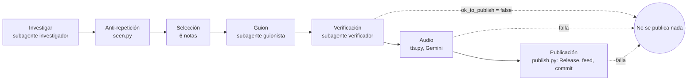

# Radar IA

Radar IA es un podcast diario de noticias de inteligencia artificial en español rioplatense. Cada mañana trae seis titulares, qué le sirve a quien programa, qué se puede ofrecer hoy con datos e IA y una cosa para probar. Está pensado para quien trabaja con datos o desarrolla, y para pymes y equipos que todavía usan Excel, WhatsApp o sistemas básicos.

Escuchalo desde tu app de podcasts con el feed RSS: https://rodrezmo.github.io/ai-daily-podcast/feed.xml

Sitio con los episodios: https://rodrezmo.github.io/ai-daily-podcast/

Los guiones los escriben agentes de Claude y el audio sale de Gemini TTS.

## Cómo se arma un episodio



`prompts/orchestrator.md` describe el pipeline diario. Si algo falla, no se publica nada: un episodio faltante es mejor que uno roto. Si no hay seis notas buenas, tampoco hay episodio ese día.

## Agentes y modelos

Según `shows/ia.yaml`:

| Agente | Qué hace | Modelo | Esfuerzo |
|---|---|---|---|
| Investigador (`prompts/researcher.md`) | Junta candidatas de las fuentes de `sources` | sonnet | medium |
| Guionista (`prompts/writer.md`) | Escribe el guion a dos voces | opus | high |
| Verificador (`prompts/verifier.md`) | Chequea cada dato contra la fuente y corrige el guion | sonnet | low |

El orquestador (`prompts/orchestrator.md`) coordina los pasos. Su modelo no figura en `shows/ia.yaml`.

## Estructura
- `shows/<id>.yaml`: configuración de cada show (temas, fuentes, voces, largo, modelos). Un show nuevo es un yaml nuevo.
- `prompts/`: instrucciones de cada agente.
- `scripts/tts.py`: guion a MP3 (Gemini TTS; edge-tts como respaldo solo si `tts.edge_fallback` está en `true`).
- `scripts/seen.py`: filtra notas ya usadas (`state/seen.json`).
- `scripts/feed.py`: arma y valida el RSS.
- `scripts/publish.py`: sube el MP3 a Releases, actualiza feed y estado, commit y push.
- `.github/workflows/`: `publish.yml` genera el audio y publica cuando llega un guion a `main`; `watchdog.yml` avisa si a las 07:30 (ART) no está el episodio del día en el feed.
- `docs/`: GitHub Pages (`feed.xml` e `index.html`).
- `episodes/<show>/<día>/`: archivos de trabajo de cada episodio (los `.mp3` no se commitean).

## Uso local
```bash
python3 -m venv .venv && .venv/bin/pip install -r requirements.txt
brew install ffmpeg
echo 'GEMINI_API_KEY=...' > .env   # gratis desde Google AI Studio; está en .gitignore
set -a && . ./.env && set +a
.venv/bin/python scripts/tts.py --show ia --script guion.txt --out episode.mp3 --title "Prueba"
```
